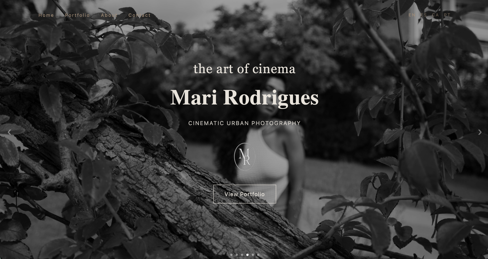

# Marina Rodrigues Photography

Official portfolio for Brazilian photographer and filmmaker Marina Rodrigues. The site brings together commercial photography, contact and booking information, and an editorial space for Marina’s independent work.

[Visit the live website](https://marinarodriiphoto.com)

## Overview

The website gives clients a direct path from browsing Marina’s photography to starting a booking conversation. The Artistic Projects section gives her independent photography and films their own editorial space within the same visual identity.

## Screenshots

| Home | Commercial Portfolio |
| --- | --- |
|  |  |

[Mobile homepage](docs/screenshots/home-mobile.png) · [Contact page](docs/screenshots/contact.png)

## Features and release status

| Area | Status |
| --- | --- |
| Public website | The commercial Portfolio, About and contact experience are available on the live site. The Portfolio supports gallery filters and a keyboard-operable image viewer. |
| Artistic Projects | Six artistic projects and three accompanying films are available for local and branch preview review. The section also includes PhotoVogue, Vrse and Selin, the Brazilian Embassy competition honourable mention with the series *Mudar*, and the Palau Sessions and MONAD exhibitions. |
| Languages and accessibility | Portuguese, English, Spanish and Catalan through i18next. Responsive images, localized alternative text, keyboard gallery controls and native video controls support the artistic section. |
| Studio admin | Portfolio administration and the backend are implemented in the repository. Production admin integration and the hosted Portfolio import are still in progress. The hosted importer code and runbook are on the admin branch. |

## Stack and architecture

| Layer | Technology and responsibility |
| --- | --- |
| Frontend | React 19, React Router, Vite 8, JavaScript, CSS and i18next. Vercel hosts the public single-page app. |
| Backend | Java 21, Spring Boot, Spring Security, MySQL and Flyway. Railway is the target for the hosted API and database. |
| Media | The commercial Portfolio has a bundled image inventory. The development frontend can read Portfolio data from the public API for integration testing. The backend signs Cloudinary uploads and manages photo records. |
| Admin security | Authenticated, role-restricted API operations use server-side sessions, CSRF protection and secure production cookies. Backend credentials stay in the server environment. |

## Repository structure

```text
frontend/
  public/assets/     Static site media and local artistic preview derivatives
  src/               Routes, components, translations and development previews
  scripts/           Portfolio import planning
  tests/             Node test suites
backend/
  src/main/          Spring Boot services, persistence, configuration and migrations
  src/test/          Backend tests
docs/
  content/           Artistic draft catalogue
  screenshots/       Public site previews
```

## Local development

Use a Node release supported by Vite 8 and npm. Run these commands from the repository root.

```sh
cd frontend
npm ci
npm run dev
```

Open [Artistic Projects locally](http://127.0.0.1:5173/personal-projects) during development. The catalogue and media also appear on the designated Vercel branch preview. Production builds exclude unpublished records and media. The frontend previews run without starting the backend.

To work on the API, use Java 21 and a local MySQL development database. From `backend/`, configure the documented variables and run `./mvnw spring-boot:run`. Vite proxies the local API requests to port 8080. See the [Portfolio upload guide](docs/PORTFOLIO_UPLOAD.md) for the local database and migration procedure.

### Environment variables

Use placeholders in shared documentation. The development backend reads an optional ignored `backend/.env` file in Java properties format. Configure production values through the hosting services.

| Scope | Variables | Example or purpose |
| --- | --- | --- |
| Local database | `DEV_DB_URL`, `DEV_DB_USERNAME`, `DEV_DB_PASSWORD` | `jdbc:mysql://127.0.0.1:3306/<dev-database>`, `<dev-user>`, `<dev-password>` |
| Production API | `SPRING_PROFILES_ACTIVE`, `DB_URL`, `DB_USERNAME`, `DB_PASSWORD` | `production`, `jdbc:mysql://<mysql-host>:3306/<database>`, `<db-user>`, `<db-password>` |
| Backend media | `CLOUDINARY_CLOUD_NAME`, `CLOUDINARY_API_KEY`, `CLOUDINARY_API_SECRET` | `<cloud-name>`, `<api-key>`, `<api-secret>` |
| Local Portfolio integration | `VITE_PUBLIC_PORTFOLIO_API` | Set to `true` in the frontend development environment to exercise the local Portfolio API. |
| Local admin over HTTP | `ADMIN_SESSION_COOKIE_SECURE` | Set to `false` for local HTTP only. The production profile enforces secure cookies. |

## Quality checks

From `frontend/`:

```sh
node --test tests/*.test.js
npm run lint
npm run build
npm run preview
```

From `backend/`, run `./mvnw test` when working on the API. Follow the documented development database procedure before running any database-backed checks.

## Technical documentation

- [Artistic preview and release](docs/ARTISTIC_RELEASE.md)
- [Design system](docs/DESIGN_SYSTEM.md) and [site structure](docs/SITE_STRUCTURE.md)
- [Frontend implementation notes](docs/FRONTEND_COMPLETION.md)
- [Admin requirements](docs/ADMIN_REQUIREMENTS.md) and [Portfolio upload and database workflow](docs/PORTFOLIO_UPLOAD.md)
- [Hosted Portfolio importer runbook on the admin branch](https://github.com/lorenasferreira/marinarodriiphoto/blob/feature/marina-admin/docs/PORTFOLIO_PRODUCTION_IMPORT.md)

## Credits

Designed and developed by **[Lorena Ferreira](https://lorenaferreira.dev)** for **Marina Rodrigues Photography**.
